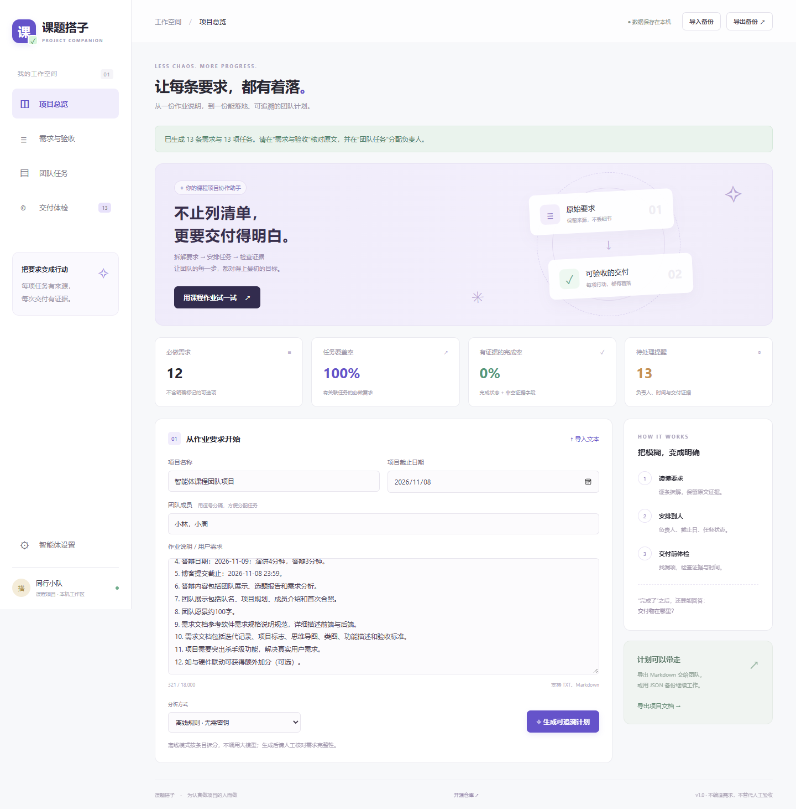

## 项目信息

| 项目            | 内容                                 |
| --------------- | ------------------------------------ |
| 课程作业        | 软件工程——团队项目第一次作业         |
| 开发语言        | JavaScript，Html                     |
| 成员 1          | 李文争    3124004171                 |
| 成员 2          | 邓子豪    3124004162                 |
| 成员 3          | 黄琪   3124004169                    |
| GitHub 项目地址 | https://github.com/LS-XH/TeamProject |

# 课题搭子

把课程作业要求变成可追溯的需求、关联任务与证据验收清单。

[在线使用](https://keti-dazi-lsxh.leoxinghen.chatgpt.site) · [项目博客](https://keti-dazi-lsxh.leoxinghen.chatgpt.site/blog) · [需求说明](docs/SRS.md) · [Planning](Planning.md) · [答辩讲稿](docs/defense.md)



## 能做什么

- 粘贴或导入TXT/MD要求；内置本次课程作业示例。
- 用离线规则拆分，或通过本站后端调用DeepSeek生成结构化需求。
- 保留逐字原文，修改需求标题、优先级和验收标准。
- 关联任务、负责人、截止日期、状态和交付证据。
- 查漏项、无负责人、日期风险和“已完成却没有证据”。
- 分开显示任务覆盖率与有证据的完成率。
- 本机自动保存，JSON备份交接，Markdown导出；原文条目比较和上次生成恢复。

**真实模型调用尚未验证**：没有可用密钥；模型协议测试使用mock。离线规则不是大模型，也不保证语义拆分质量。证据真实性需要人工检查。

## 本地运行

Node.js 22以上：

```bash
npm ci
npm test
npm run dev
```

打开 [http://127.0.0.1:4173](http://127.0.0.1:4173)。首次安装后点击“用课程作业试一试”，再点击生成。

```bash
npm run build
npm run validate
```

构建输出为 `dist/server/index.js`，Cloudflare Worker兼容ESM，无运行依赖。安装的marked仅在构建时将仓库内可信博客转为HTML；playwright-core只用于本地浏览器检查。构建不会把它们部署到运行时。

浏览器检查（需已有Edge/Chrome，可通过BROWSER_PATH指定）：

```bash
# 在另一个终端运行 npm run dev
npm run test:e2e
```

在线匿名浏览器检查：`npm run test:online`（需本机Edge）。平台可能阻止普通命令行HTTP客户端，脚本同时记录这一差异；在线结果见 [online-results.json](docs/online-results.json)。

## 连接智能体

点击“智能体设置”，填入自己的DeepSeek API Key和当前有效模型名，再切换为DeepSeek模式。密钥不写入本地项目或备份，刷新即清除。请求正文会经本站转发至DeepSeek；不要发送敏感资料。调用费用属于对应API账户。规则模式无需密钥。

服务端固定调用 `https://api.deepseek.com/chat/completions`。使用结构化JSON输出，验证需求引用逐字存在于原文，再创建任务。失败不会覆盖已有计划。一个需求分析智能体配合校验与体检工具，不包装成多智能体。

## 项目结构

```text
src/core.js       领域规则、模型输出校验、审查与导出
src/server.js     API与DeepSeek协议
src/client.js     浏览器交互与本机保存
src/index.html    应用界面
src/style.css     响应式样式
scripts/         构建、本地服务、验证
tests/           领域、接口与浏览器测试
docs/            需求、调研、博客、答辩、检查与交付说明
.openai/         Sites部署标识
```

## 数据与范围

单浏览器单项目；没有云端数据库与实时多人同步。清理浏览器会丢失本机数据，重要项目请下载JSON备份。恢复上一计划只在当前页面内保留。截止检查按日期比较，不做定时通知。模型和证据都需要人工核对。

## 作业交付资料

| 内容 | 位置 |
| --- | --- |
| 规划 | [Planning.md](Planning.md) |
| 原作业要求 | [assignment.md](docs/assignment.md) |
| 团队展示与愿景 | [team.md](docs/team.md) |
| 调研账本与后续方案 | [research.md](docs/research.md) |
| 需求规格、思维导图与类图 | [SRS.md](docs/SRS.md) |
| 博客Markdown | [blog.md](docs/blog.md) |
| 答辩讲稿与问答 | [defense.md](docs/defense.md) |
| 六页答辩PPT | [课题搭子-选题答辩.pptx](docs/presentation/课题搭子-选题答辩.pptx) |
| 测试记录 | [testing.md](docs/testing.md) |
| 发布和缺口 | [delivery.md](docs/delivery.md) |

团队真实成员、学号、合照、课程链接未提供；真实用户访谈和模型端到端验证未完成。所有相关材料均明确标记，不虚构经历。自动发布不等于课程平台提交完成。

## 许可与责任

本仓库采用MIT许可，见 [LICENSE](LICENSE)。AI编程助手根据用户指令生成初版；实际团队贡献需由成员据实登记。
