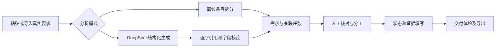
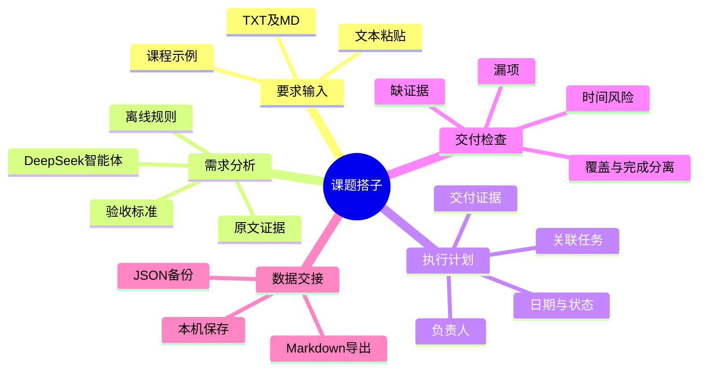
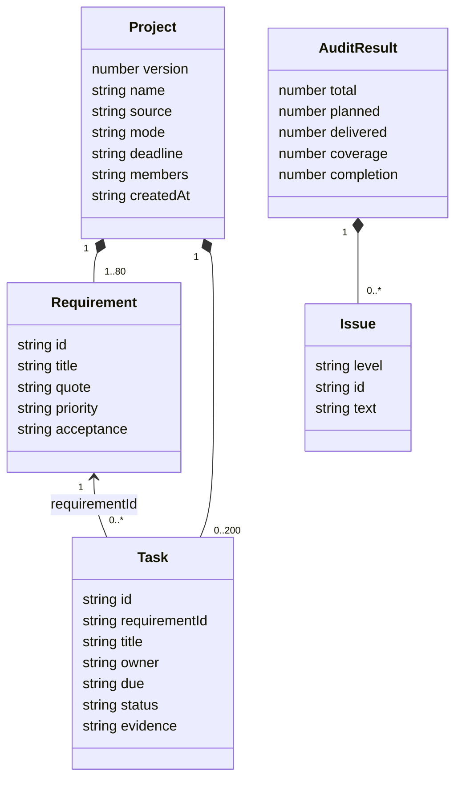

# 课题搭子 软件需求规格说明书

文档编号：KDZ-SRS-001；版本1.0；日期2026-11-08；状态：随MVP交付的验收基线。

## 0. 修订记录

| 版本 | 日期 | 修改内容 | 修改来源 |
| --- | --- | --- | --- |
| 0.1 | 2026-11-08 | 从作业材料确定范围、用户与边界 | 用户作业说明与AI整理 |
| 0.2 | 2026-11-08 | 明确原文校验、规则降级、任务和验收指标 | 实现设计 |
| 1.0 | 2026-11-08 | 与实现核对，记录验证范围及资料缺口 | 代码与自动化检查 |

以上是本次交付内的文档迭代记录，不代表此前已进行多轮团队会议。

## 1. 引言

### 1.1 目的

明确课题搭子MVP的前后端行为与验收条件，供教师、助教、开发维护者检查。本文描述已选择实施的范围，未来想法不作为默认需求。

### 1.2 参考资料

- [GB/T 9385-2008《计算机软件需求规格说明规范》官方条目](https://std.samr.gov.cn/gb/search/gbDetailedCNF?id=71F772D7FB12D3A7E05397BE0A0AB82A)。以引言、总体描述、具体需求及附录组织本文，不宣称经标准认证或完成全文逐条符合性审查。
- [课程要求整理](assignment.md)。
- [需求证据账本](research.md)。
- [DeepSeek官方接口](https://api-docs.deepseek.com/api/create-chat-completion/)。

### 1.3 术语

需求：原文中一项要满足的交付或约束。任务：关联一项需求的行动记录。证据：由使用者提供的链接、文件位置或验收说明。任务覆盖率：必做需求中至少有一个任务的比例。有证据完成率：必做需求中所有关联任务均为完成且证据字段非空的比例。证据非空不等于证据真实。

## 2. 总体描述

### 2.1 产品定位和用户

面向课程团队成员和组长，辅助教师与助教查看导出的需求交付文档。当前不区分账号权限，所有浏览器用户均操作各自本机项目。老师查看线上应用时不会自动看到学生本机保存的项目。

### 2.2 使用环境

现代支持ES模块、Fetch、dialog、localStorage的浏览器；宽度390px起的移动端与桌面。后端为Cloudflare Worker ESM。本地运行要求Node 22以上。无需数据库、Docker或浏览器插件。

### 2.3 总体流程



### 2.4 限制

单浏览器单项目，不提供实时多人编辑。JSON人工交接时由团队自行协调覆盖顺序。无真实访谈数据。用户自备模型密钥；无密钥仍能使用明确标注的规则模式。AI可能漏项或误判，原文校验仅证明引用存在，不能证明解释一定正确。

## 3. 项目标志与思维导图

项目标志：紫底“课”字与绿色对勾，表示课程要求与交付核对。实现为网页CSS和文本，资源位于 `src/index.html` 与 `src/style.css`，不依赖外部图片。



## 4. 数据与类图

本系统用JavaScript对象表达领域结构，下图是概念类图，不声称源代码使用了同名面向对象类。



数据约束：version固定1；需求ID为R加三位数字，任务ID由系统按T加数字生成。优先级P0/P1为必做、P2为可选。任务状态todo/doing/done。日期为YYYY-MM-DD，不做分钟级排程。导入拒绝重复ID、无效状态、坏关联和不在原文中的引用。模型密钥不属于领域对象。

## 5. 前端功能需求

| ID | 功能与行为 | 输入或边界 | 验收标准 |
| --- | --- | --- | --- |
| FR01 | 原始要求输入与文件导入 | 正文1—18000字符；TXT/MD最多80000字节 | 文件内容进入编辑器；超限显示错误 |
| FR02 | 示例填充 | 内置真实课程说明的摘要 | 点击后不自动请求模型，用户点击生成 |
| FR03 | 项目元信息 | 名称、日期、成员列表 | 生成项目后修改可保存；成员可用于分配 |
| FR04 | 模式选择 | rules/ai | 显示模式说明；离线不宣传为大模型 |
| FR05 | 需求查看与编辑 | 原文引用只读；标题、验收标准和优先级可修改 | 改动在刷新后仍在；原文引用保留 |
| FR06 | 任务安排 | 需求关联、负责人、日期、状态和证据 | 各字段修改后保存并刷新指标 |
| FR07 | 任务增删 | 最多200个；默认新任务关联第一条需求 | 删除导致漏项时体检提示；新增可改关联 |
| FR08 | 风险体检 | 无任务、坏关联、未分工、晚于总截止、完成无证据 | 产生带ID的明确提醒 |
| FR09 | 统计 | 仅P0/P1进入必做分母 | 有任务但未完成时覆盖率100%、完成率0% |
| FR10 | 本机自动保存 | 当前项目写localStorage | 刷新可恢复；存储失败提示导出 |
| FR11 | JSON备份与恢复 | 最多500KB并校验结构 | 合法备份可导入；非法备份不覆盖项目 |
| FR12 | Markdown导出 | 完整项目 | 含模式、需求、原文、标准、任务、风险 |
| FR13 | 原文变更比较 | 基于换行及分号的条目差异 | 提示增删数量并展示条目；非语义版本分析 |
| FR14 | 生成恢复 | 页面内保留上一项目 | 重新生成成功后可恢复；刷新后恢复点清除 |
| FR15 | 密钥设置 | 当前页面内存 | 刷新密钥清除；备份与localStorage不含密钥 |
| FR16 | 响应式与可访问性 | 桌面及390px手机；键盘 | 无水平溢出；表单有标签，状态有aria-live |

## 6. 后端接口和智能体需求

### 6.1 POST /api/plan

JSON请求：

```json
{
  "source": "应用必须上线运行。",
  "mode": "ai",
  "apiKey": "用户本次请求提供的密钥，不保存",
  "model": "deepseek-chat",
  "meta": {"name": "课程项目", "deadline": "2026-11-08", "members": "小林，小周"}
}
```

rules模式不使用apiKey和model。成功返回version、name、deadline、members、source、mode、createdAt、requirements、tasks组成的Project，不回传密钥。初始任务均为待开始、待分配负责人，每条需求关联一个默认任务。

| 状态 | 条件 | 响应 |
| --- | --- | --- |
| 200 | 正常计划 | Project JSON |
| 400 | 空正文、超限、非法模式、缺少密钥、非法模型名 | error字符串 |
| 403 | Origin不等于本站 | error字符串 |
| 405 | 非POST | error字符串 |
| 413 | 请求过大 | error字符串 |
| 502 | 上游错误、无效JSON、坏引用、截断、网络错误 | 通用错误或校验说明，不回显上游正文 |
| 504 | 模型调用60秒超时 | 明确超时说明 |

### 6.2 智能体行为

BR01：只向固定 `https://api.deepseek.com/chat/completions` 请求，不接受任意用户URL。BR02：系统提示要求把用户材料视为数据，提取结构化需求与验收标准；不能编造调研或成员。BR03：使用JSON对象输出，max_tokens为6000。BR04：必须有正常停止标记stop；每条需求必须提供原文逐字非空片段，且title和acceptance完整、长度不超过1200。BR05：引用校验失败就拒绝整个输出，保留浏览器旧计划。BR06：通过后程序生成稳定需求ID和任务关联，再由规则函数进行交付检查。

一个智能体加确定性工具链；不是多个独立自治智能体。当前没有自动多轮纠错和自动联网调研。实时模型质量与当前模型名可用性需要真实服务验证；本轮仅完成模拟协议测试，未完成付费真实调用。

### 6.3 其他HTTP行为

GET/HEAD `/`、`/style.css`、`/client.js`、`/health` 提供界面与健康检查。未知路径404。前端代码与CSS由同源Worker提供。`/blog`作为交付文章页面。Worker无用户数据库，不跨访客存储正文。浏览器导入备份及编辑任务无需请求后端。

## 7. 体检与指标规则

设必做集合为priority不等于P2的需求集合B：

- covered(r)：存在关联任务。
- delivered(r)：至少存在一个关联任务，且这些任务全部done并填写非空evidence。
- 覆盖率 = round(covered数量 / B数量 × 100)。
- 有证据完成率 = round(delivered数量 / B数量 × 100)。
- B为空时两项均为0，避免除零与虚假100%。

错误提醒：必做需求无任务、已完成缺证据、任务日期晚于项目日期、孤立需求关联。警告：负责人未分配。信息：可选需求无任务。**当前不检查任务日期是否已经过了今天，也不检查“上线链接”是否真实可用。**

## 8. 非功能要求

| ID | 要求 | 验证方式及边界 |
| --- | --- | --- |
| NFR01 | 密钥不写入项目、备份、日志或固定服务端密钥库 | 代码与浏览器存储检查；仅当前请求内存 |
| NFR02 | 用户文本不作为HTML执行 | 动态文本转义；恶意HTML浏览器检查 |
| NFR03 | 不任意代理外部网络 | 模型服务域名固定；Origin同源检查 |
| NFR04 | 生成失败保留已有计划 | 前端成功校验后才赋值；错误接口测试 |
| NFR05 | 可重复构建、可本地运行 | npm ci/test/build/validate；运行时零依赖 |
| NFR06 | 不加载远程前端脚本、字体和图片 | CSP同源资源；静态代码检查 |
| NFR07 | 公开演示可用且模式清晰 | Sites部署状态、公开链接；真实AI调用单独核验 |

性能边界：离线解析为最多80条，项目最多200任务。未开展并发负载和大规模性能测试，不承诺响应时间SLA。localStorage不是加密存储，勿输入敏感资料。请求经HTTPS时由托管平台加密传输；本站不提供项目备份的加密功能。

## 9. 用例与验收映射

| 用例 | 操作 | 预期 | 验证文件 |
| --- | --- | --- | --- |
| UC01 创建计划 | 示例加规则生成 | 逐条引用、默认任务；完成率0 | tests/core.test.mjs、tests/browser.mjs |
| UC02 使用智能体 | 输入正文、模型和密钥 | 校验JSON、原文和正常结束；失败不生成 | tests/api.test.mjs；真实API调用待验证 |
| UC03 准备交付 | 任务标完成但不填证据 | 体检出现缺证据错误 | core和浏览器测试 |
| UC04 检查遗漏 | 删除唯一关联任务 | 覆盖率下降，出现无任务提醒 | core和浏览器测试 |
| UC05 保留成果 | 刷新、备份、导入、导出 | 恢复项目；不包含密钥 | 浏览器测试 |
| UC06 更新要求 | 修改原文再生成 | 展示增删条目，可恢复上次计划 | core和浏览器测试 |
| UC07 手机上操作 | 390px视口 | 不横向溢出，可导航 | 浏览器测试 |

## 10. 未完成事项与变更控制

真实成员、学号、首次合照、班级与作业链接、用户访谈、真实模型响应未提供或未验证。它们是作业或证据缺口，不应以程序测试通过代替。

需求变更需同步本文、Planning、测试和博客中的能力描述。新增未来功能要先写清输入输出、验收办法和责任人，不自动成为本轮交付承诺。
