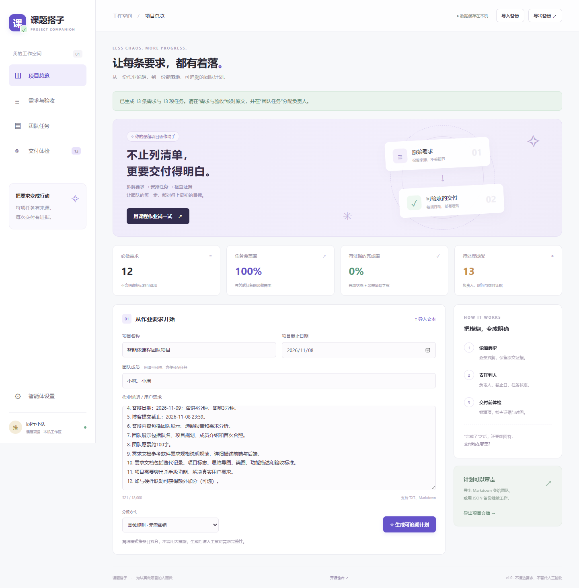
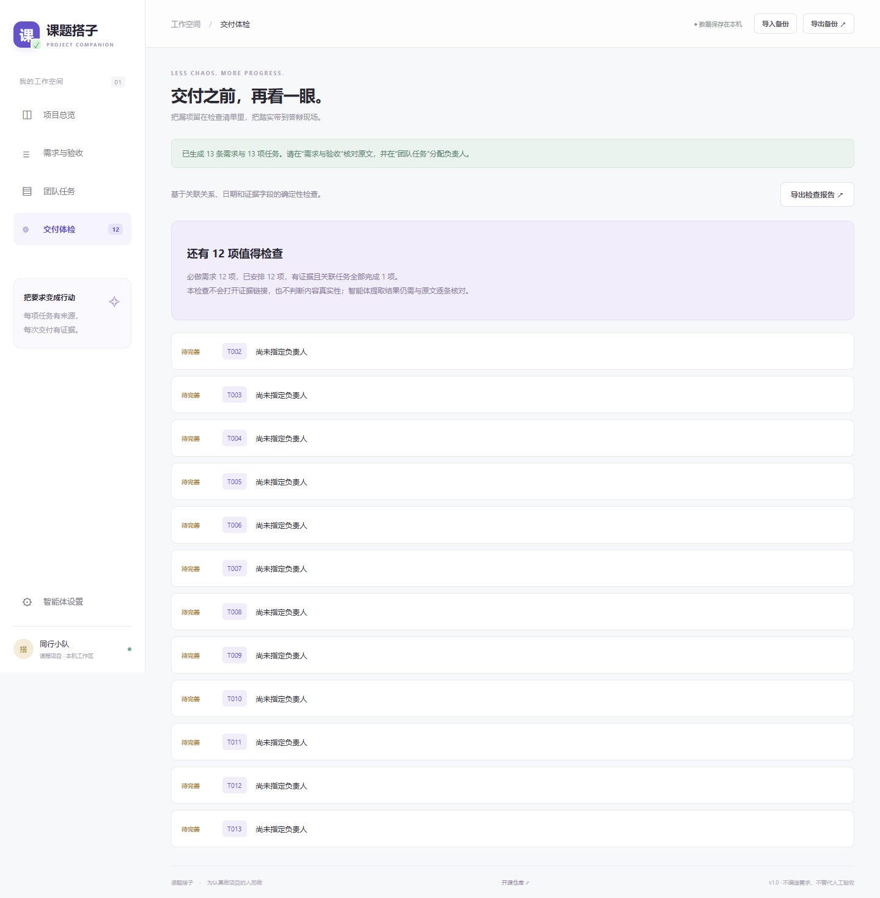

项目代码仓库：[https://github.com/LS-XH/TeamProject](https://github.com/LS-XH/MyUniverse)

| 这个作业属于哪个课程     | [计科 24 级 56 班](https://edu.cnblogs.com/campus/gdgy/Class56-Grade2024-CS) |
| ------------------------ | ------------------------------------------------------------ |
| 这个作业要求在哪里       | [团队项目第一次作业 ](https://edu.cnblogs.com/campus/gdgy/Class56-Grade2024-CS/homework/16766) |
| 我希望在这门课达到的目标 | 从真实需求出发，把智能体嵌入软件，完成选题、需求分析、可运行原型和可核验交付，理解团队协作与验收之间的关系 |

# 团队项目第一次作业：课题搭子，让每条作业要求都有着落

## 一、团队展示：希望成为认真做项目的同行者

### 1. 队名和项目

队名：海底小纵队

项目名为“课题搭子”。“同行”表达一起读懂要求、分工协作、共同交付的愿望；“搭子”表示辅助团队行动的助手。

### 2. 团队项目的具体规划及描述

课题搭子是一个面向课程团队项目的Web工作台。输入老师的作业说明，系统把材料拆成带原文证据的需求，再生成关联任务。团队可以修改验收标准、安排负责人、填写完成状态和交付证据，并在交付前检查遗漏。

### 3. 队员风采

| 姓名 | 学号 | 擅长的技术 | 兴趣爱好 | 希望的软工角色 |
| --- | --- | --- | --- | --- |
| 李文争 | 3124004171 | Js，LangChain，Agent | 打羽毛球 | Agent开发 |
| 邓子豪 | 3124004162 | Vue、HTML/CSS | 打球、看书 | 前端开发 |
| 黄琪 | 3124004169 |  |  |  |

### 4. 首次合照

### 5. 项目愿景

我们希望让每个认真做课程项目的团队，都能把老师的要求读清楚，把伙伴的分工安排明白，把自己的成果展示完整。课题搭子从需求原文出发，让每项任务有来源、每次完成有证据。未来通过真实用户的反馈持续改进，让协作少一些遗漏，让答辩多一份踏实，让技术服务于共同成长。

## 二、选题报告：从这次作业本身发现问题

### 1. 需求来源

本项目的需求来源包括本次课程作业说明，以及围绕课程团队协作开展的角色模拟调研。作业说明同时要求上线程序、团队介绍、首次合照、需求文档、博客和现场答辩，需求文档还会成为最终验收依据。不同类型的交付物需要分配到人、跟进进度，并在提交前逐项检查，这构成了选题的真实场景基础。

**调研方式与范围。** 为了进一步分析这个场景，我们使用AI扮演课程项目中的组长、开发成员、文档负责人和答辩负责人，围绕“阅读要求—分配任务—跟进进度—交付检查”进行模拟访谈。以下角色、话语和情境均为模拟生成，不对应真实受访者；这次工作用于提出和检查需求假设，不作为已完成真实访谈、问卷或用户验证的证明。

**模拟访谈关注的问题：** 作业要求通常如何整理？团队如何确定每个人要做什么？成员说“完成”时提供什么材料？临近截止日期如何检查遗漏？现有聊天或待办工具还留下了哪些需要人工处理的工作？

| 模拟角色 | 模拟访谈片段（非真实引语） | 推导出的需求假设 |
| --- | --- | --- |
| A：课程项目组长 | “群里说了谁做哪部分，但我还要回到作业页面，确认每条要求到底有没有安排。” | 任务需要关联原始要求，并显示哪些需求还没有任务 |
| B：开发成员 | “任务只写‘把后端做好’，我不清楚做到哪一步才算完成，也不知道最后要交什么。” | 每项需求需要明确验收标准，任务需要负责人和截止日期 |
| C：文档负责人 | “程序已经能跑，最后整理博客时才发现合照、类图和团队介绍还没有准备。” | 任务清单应同时容纳代码、文档和团队展示等交付物 |
| D：答辩负责人 | “大家都说完成了，但演示地址、截图和测试结果分散在不同地方，准备答辩还得重新找。” | 完成状态需要附带可定位的交付证据，并集中检查缺证据任务 |

**需求归纳与功能取舍。** 这些模拟情境提示我们关注三个具体问题：要求与任务之间缺少对应关系，容易产生未安排的交付物；“完成”的定义不清晰，容易出现进度认知差异；成果材料分散，难以在提交和答辩时迅速定位。因此，课题搭子把核心功能确定为“原文引用、需求与任务关联、验收标准、交付证据及漏项检查”。

| 需求线索 | 对应产品功能 | 当前验收方式 |
| --- | --- | --- |
| 无法判断要求是否全部安排 | 需求ID与关联任务、任务覆盖率 | 删除某项需求唯一的任务，系统提示该需求未被覆盖 |
| 对完成标准理解不一致 | 可编辑的验收标准、负责人和日期 | 查看需求标准并修改分工，刷新后仍保留记录 |
| 声称完成但找不到成果 | 交付证据字段与体检提醒 | 把任务设为完成却不填证据，系统提示缺少交付证据 |
| 非代码交付物容易被忽略 | 将博客、合照、文档和答辩材料作为普通需求管理 | 输入相关原文条目后，能生成关联任务并进行检查 |

对于模拟中可能提出的自动催办、实时多人编辑等诉求，本轮没有直接纳入范围。先完成可运行、可检查的需求与交付流程，再通过真实团队使用决定是否扩展，避免把所有设想都写成必须实现的功能。

**结论与验证边界。** 通过作业材料分析和角色模拟，我们形成了一个可实施的选题假设：课程团队需要一个能把“老师要求、成员任务与成果证据”联系起来的轻量工具。目前已经实现原型，并验证了上述检查规则；模拟调研不能证明这些问题的普遍程度，也不能证明工具提升了效率。后续应邀请真实同学使用自己的作业完成任务，记录实际困难和反馈，再修订需求。模拟记录与真实证据的区分见[需求调研与证据账本](https://github.com/LS-XH/TeamProject/blob/main/docs/research.md)。

### 2. 目标用户与实际场景

目标用户是课程团队组长与成员。组长可以把要求整理成计划，成员查看关联任务和验收标准，交付前共同检查文档与成果。老师、助教可以运行应用，并查看团队主动分享的导出文档。

当前项目保存在各自浏览器，不提供实时多人协作。团队通过JSON备份人工交接，或通过Markdown文档共同评审。

### 3. 功能：能从原文查到交付

项目的核心链路是“原始要求—需求ID—关联任务—交付证据”。

例如原文写“应用最终需要上线运行”，系统保留原文片段并分配需求ID。团队给关联任务安排负责人，完成后填写演示网址。如果只勾选“已完成”却没有证据，交付体检会明确提示。如果删除这项需求唯一的任务，系统会提醒该需求没有被安排。

任务覆盖率回答“有没有安排”，有证据的完成率回答“关联任务是否全部完成且填写证据”。这两种指标分开显示，避免刚生成计划就出现“项目完成100%”的错觉。证据只是用户填写的内容，真实性仍需人工打开核验。

### 4. 创新点与边界

创新集中于课程场景中的交付追溯：AI提取结果必须带原文；计划和证据检查在同一个应用里；原文变化时提示新增、删除条目；生成新计划后可在当前页面恢复上一份。

没有声称发明全新的需求管理方法。设计参考了[NASA需求管理资料](https://www.nasa.gov/reference/6-2-requirements-management/)中的追溯思路，并针对小型课程团队做了简化。适用范围可扩展到实验、小组报告等有明确交付要求的任务，但尚未完成这些场景的用户验证。

## 三、需求分析与验收设计

### 1. 需求文档基线

需求说明按引言、总体描述、具体要求与验收映射组织，参照[GB/T 9385-2008官方标准条目](https://std.samr.gov.cn/gb/search/gbDetailedCNF?id=71F772D7FB12D3A7E05397BE0A0AB82A)，不宣称通过认证或完成全文符合性审查。完整文档含迭代记录、项目标志、思维导图、类图、前后端需求与验收标准，见[软件需求规格说明书](https://github.com/LS-XH/TeamProject/blob/main/docs/SRS.md)。

| 能力 | 当前实现 | 验收方法 |
| --- | --- | --- |
| 输入 | 粘贴、TXT/MD导入、示例 | 内容进入编辑器；超限报错 |
| 需求分析 | 离线规则或DeepSeek接口 | 模式清晰，需求带逐字原文 |
| 人工核对 | 修改标题、优先级和标准 | 刷新后保留修改 |
| 任务安排 | 需求关联、负责人、日期、状态、证据 | 改动更新统计与体检 |
| 交付检查 | 漏任务、未分工、日期风险、缺证据 | 对应操作产生明确提醒 |
| 数据交接 | 本机保存、JSON备份、Markdown导出 | 刷新恢复及导出导入 |
| 变更处理 | 条目差异提示、上次计划恢复 | 显示变化并恢复旧计划 |

### 2. 前端设计

工作台包含项目总览、需求与验收、团队任务、交付体检四个页面。总览提供输入和指标；需求页用于核对引用与标准；任务页记录分工和证据；体检页集中显示需要处理的问题。界面适配桌面与390px移动视口，动态用户文本经过HTML转义。



### 3. 后端与智能体嵌入

后端为Cloudflare Worker，前端通过本站 `POST /api/plan` 请求计划。智能体模式由后端向固定DeepSeek域名发起请求，以JSON输出需求、原文引用、优先级和验收标准。程序检查字段、原文引用与正常结束状态，通过后才创建关联任务并交给规则体检工具。

这是一个需求分析智能体加确定性检查流程，不宣称多个独立智能体协作。接口依据为[DeepSeek官方Chat Completions文档](https://api-docs.deepseek.com/api/create-chat-completion/)。

访问者提供自己的密钥；密钥只在当前页面和请求内存中使用，不写入项目数据或备份，刷新后清除。使用智能体时，正文会发送到DeepSeek，界面明确提示这一点。

本轮没有可用模型密钥，因此只完成了模拟上游响应的协议测试，**未完成真实模型端到端调用**。离线规则模式可以实际演示，但它只是按条目拆分，验收标准也较通用，不能冒充语义智能分析。模型真实调用与质量验证仍是交付限制。

### 4. 当前范围

已实现的功能以需求文档为准。没有实时多人编辑、云端项目库、自动通知、自动检查证据网页或硬件联动。当前日期检查只比较任务日期是否晚于项目日期，不提供自动催办。

## 四、开发规划与验证

### 1. Planning与技术取舍

先确定范围和验收口径，再实现领域规则、模型接口与界面，之后进行浏览器检查、材料整理和发布。详细规划见[Planning](https://github.com/LS-XH/TeamProject/blob/main/Planning.md)。

采用原生HTML/CSS/JavaScript和单Worker，减少运行依赖；浏览器本机存储降低部署复杂度；保留JSON备份用于交接。代价是没有实时多人协作，浏览器清理数据后需要备份恢复。

### 2. 检查结果与修复

本轮执行了25项Node自动化测试，以及13项Edge浏览器流程检查。检查覆盖引用捏造、非法模型输出、超时、跨站请求、统计规则、备份、任务编辑和移动端。模型协议使用mock响应，没有把它记录成真实服务成功。

测试中发现示例标题会被计作需求，之后调整了示例。截图检查又发现“可选择平台”被规则误判成可选需求，随后收紧匹配并补充回归测试。两次发现都说明：有输出并不等于输出正确，需求规则也需要验证。



详细范围与限制见[测试记录](https://github.com/LS-XH/TeamProject/blob/main/docs/testing.md)。没有做真实用户可用性研究、并发压力测试或模型质量基准，不报告不存在的提效数据。

## 五、上线入口与复现

- [在线应用](https://keti-dazi-lsxh.leoxinghen.chatgpt.site)
- [GitHub源码](https://github.com/LS-XH/TeamProject)
- [需求分析文档](https://github.com/LS-XH/TeamProject/blob/main/docs/SRS.md)
- [答辩讲稿与问答](https://github.com/LS-XH/TeamProject/blob/main/docs/defense.md)
- [六页答辩PPT](https://github.com/LS-XH/TeamProject/blob/main/docs/presentation/课题搭子-选题答辩.pptx)

本地要求Node 22或以上：

```bash
npm ci
npm test
npm run dev
```

浏览器打开本地终端显示的地址，点击“用课程作业试一试”，选择离线规则并生成计划。需要真实智能体时，在设置中填写自己的DeepSeek密钥及有效模型名，再切换模式。

本博客页面和GitHub内容发布不等于向课程平台提交作业；队长仍需要按课程指定方式提交链接。

## 六、反思与待补材料

这个原型让我们更清楚地看到，软件工程的交付既包括代码，也包括对需求来源、责任边界和验收证据的说明。系统可以帮助团队记录事实，但不能替团队获得真实用户反馈，也不能把勾选状态变成真实交付。

下一步优先补齐真实成员与合照，开展访谈和实际任务测试，再用真实密钥验证智能体效果。是否增加实时协作，应由这些反馈决定。现阶段不把未来功能写成已经实现的成果。

仍缺：班级链接、原作业链接、真实学号与姓名、成员风采、首次合照、真实用户访谈、真实模型调用记录、课程平台最终提交确认。
