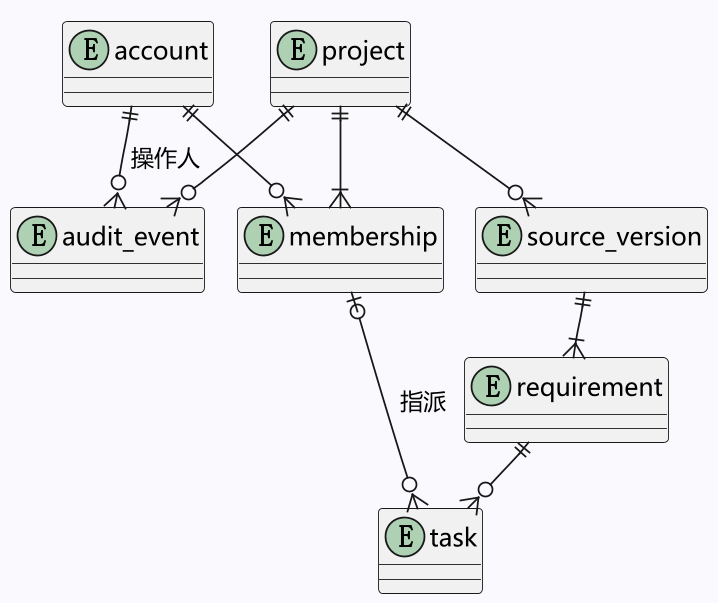

# 海底小纵队第二次团队作业——原型设计+概要设计

| 作业所属课程 | [计科24级56班](https://edu.cnblogs.com/campus/gdgy/Class56-Grade2024-CS) |
| --- | --- |
| 作业要求 | 第二次团队作业：原型设计与概要设计。班级页面需要登录，尚未核实本次作业直链 |
| 作业的目标 | 基于课题搭子第一阶段需求，明确前后台交互、系统结构和数据约束，为分工实现与验收提供设计基线 |
| 团队名称 | 海底小纵队 |
| 团队成员学号-名字 | 3124004171-李文争、3124004162-邓子豪、3124004169-黄琪 |

## 一、原型设计

课题搭子面向有课程交付任务的小组。当前可运行版本支持浏览器本机保存、计划生成和交付体检，这次原型补充了计划确认、共享版本和后台归档的交互。使用 draw.io 的交互页面与跳转链接制作了八个设计画板。前台演示组长的交付流程，后台演示管理员的归档流程。团队成员和项目内容均使用示例数据。

- 前台路径：项目总览 → 生成预览 → 核对原文 → 保存并安排任务 → 运行体检 → 填写示例证据。初始任务已标记完成但缺证据，因此任务覆盖率为100%，有证据的完成率为0%。补齐证据后仍由验收人打开链接确认。
- 后台路径：后台管理 → 查看归档确认 → 确认归档 → 查看操作日志 → 恢复。确认页支持取消。归档后的项目保留历史版本并转为只读，恢复后可继续编辑。
- 预览左栏可切换两条路径。原型用页面跳转模拟操作；真实数据保存、后台授权和日志写入属于后续开发。

[原型在线预览](https://viewer.diagrams.net/?#Uhttps%3A%2F%2Fraw.githubusercontent.com%2FLS-XH%2FTeamProject%2Fmain%2Fdocs%2Fdesign%2F%25E8%25AF%25BE%25E9%25A2%2598%25E6%2590%25AD%25E5%25AD%2590.drawio) · [可编辑原型源文件](课题搭子.drawio)

## 二、系统概要设计

系统由表示层、应用层、领域层和数据层构成。表示层呈现学生工作台和管理控制台。应用层检查身份、访问权限、输入和项目修订号。领域层提取需求、组织任务、计算指标及执行归档。数据层负责保存版本和审计事件。设计参照 GB/T 8567—2006 第7.13节与第7.14节。统一建模语言简称 UML。

| 图 | 设计要点 |
| --- | --- |
| [用例图](usecase.png) | 区分组长、编辑者、查看者和平台管理员 |
| [活动图](activity.png) | 输入无效或引用错误时保留原计划，生成成功后须人工确认 |
| [类图](classes.png) | 以项目管理原文版本，需求连接任务，审查服务负责计算指标 |
| [时序图](sequence.png) | 模型请求与计划持久化分离，保存时核验修订号并处理冲突 |
| [协作图](collaboration.png) | 归档服务先核验权限，归档与审计在同一事务内完成 |

## 三、数据库设计

拟采用 SQLite 兼容关系模式。项目与账户通过成员表关联。每份原文和提取后的需求都归属特定版本，任务通过项目、版本和需求编号的组合外键联系需求，防止串项目。负责人必须属于同项目。覆盖率实时计算，模型密钥不保存。实体类与库表映射、数据字典、索引、备份与恢复策略见数据库说明书。

[关系模式与建表脚本](schema.sql) · [数据库设计说明书](海底小纵队_数据库设计说明书.pdf)

## 四、开发计划与团队协作

以下为以11月23日所在周为起点的内部拟议安排。各周产出作为评审和交接依据。

| 周期 | 里程碑 | 可检查产出 |
| --- | --- | --- |
| 11月23日—11月29日 | 冻结设计与接口口径 | 前后台原型评审意见、关系模型和接口样例 |
| 11月30日—12月6日 | 打通共享版本流程 | 项目成员权限、计划保存接口、原文及任务版本联调记录 |
| 12月7日—12月13日 | 验证杀手级功能和管理流程 | 缺任务与缺证据演示、归档恢复和操作记录、并发冲突用例 |
| 12月14日—12月20日 | 完成联调与演练 | 访问权限和数据恢复测试、演示网址、最终验收清单 |

| 成员 | 拟议角色 | 拟负责开发及交接 |
| --- | --- | --- |
| 李文争 | 智能体与接口 | 需求结构化提取、引用校验、保存接口契约、失败场景联调 |
| 邓子豪 | 前端开发 | 计划确认、任务与体检页面、后台列表与归档交互、移动端适配 |
| 黄琪 | 数据与质量（拟分配） | 数据库迁移和测试数据、权限与并发验收、文档和发布联查 |

本次可核验过程为读取第一阶段代码和需求基线、补齐前后台交互稿、绘制系统与数据模型、生成并核对交付件。对应源文件和提交历史均在团队仓库。上表是拟议分工，尚无本阶段成员逐项确认、会议照片和视频记录。逐人贡献以真实 GitHub 提交和审查记录为准，当前尚未核实三位成员各自的贡献。

## 五、交付入口

- [GitHub 团队仓库](https://github.com/LS-XH/TeamProject)
- [海底小纵队_系统设计说明书.pdf](海底小纵队_系统设计说明书.pdf)
- [海底小纵队_数据库设计说明书.pdf](海底小纵队_数据库设计说明书.pdf)
- [前后台交互原型在线预览](https://viewer.diagrams.net/?#Uhttps%3A%2F%2Fraw.githubusercontent.com%2FLS-XH%2FTeamProject%2Fmain%2Fdocs%2Fdesign%2F%25E8%25AF%25BE%25E9%25A2%2598%25E6%2590%25AD%25E5%25AD%2590.drawio)
- [现有工作台](https://keti-dazi-lsxh.leoxinghen.chatgpt.site)

博客正文保存在公开仓库。课程博客园随笔与班级作业提交状态待队长账号确认。
