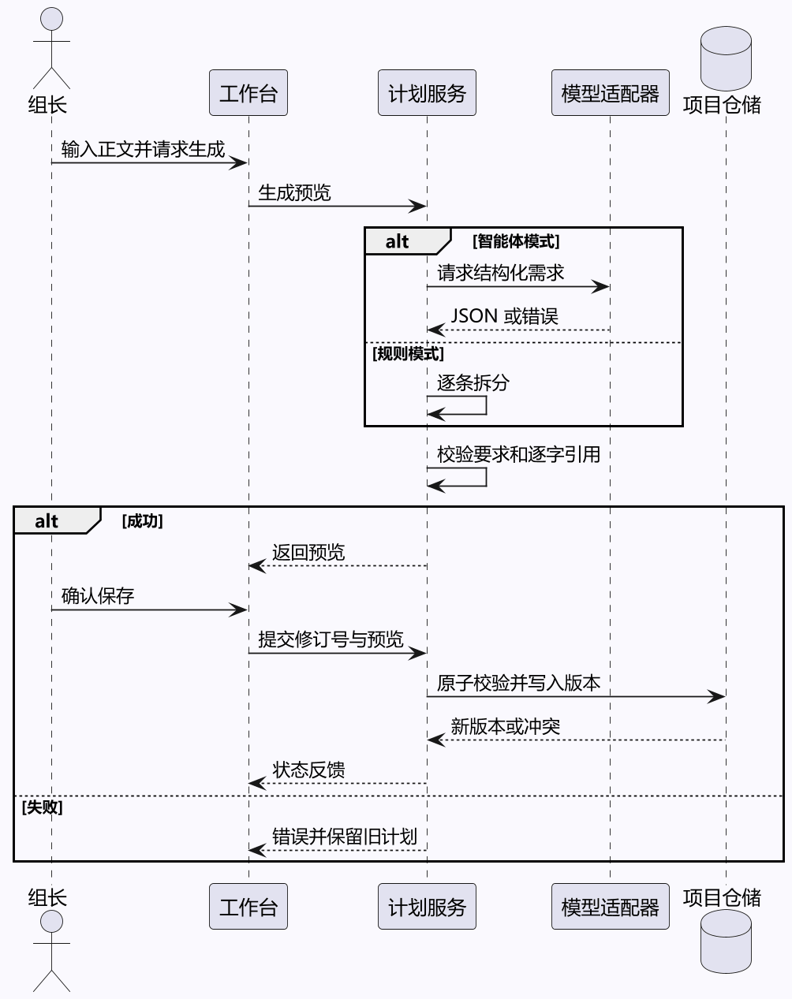

# 海底小纵队第二次团队作业——原型设计+概要设计

| 作业所属课程 | [计科24级56班](https://edu.cnblogs.com/campus/gdgy/Class56-Grade2024-CS) |
| --- | --- |
| 作业要求 | 第二次团队作业：原型设计与概要设计。班级页面需要登录，尚未核实本次作业直链 |
| 作业的目标 | 基于课题搭子第一阶段需求，明确前后台交互、系统结构和数据约束，为分工实现与验收提供设计基线 |
| 团队名称 | 海底小纵队 |
| 团队成员学号-名字 | 3124004171-李文争、3124004162-邓子豪、3124004169-黄琪 |

## 一、原型设计

课题搭子面向有课程交付任务的小组。当前可运行版本支持浏览器本机保存、计划生成和交付体检，这次原型补充了计划确认、共享版本和后台归档的交互。使用 draw.io 的交互页面与跳转链接制作了八个设计画板。前台演示组长的交付流程，后台演示管理员的归档流程。团队成员和项目内容均使用示例数据。

### 1. 前台工作台

| 画板 | 用户操作与反馈 | 实现时遵循的规则 |
| --- | --- | --- |
| 项目总览 | 粘贴作业要求，选择分析方式，点击「生成预览」 | 校验正文长度。规则模式可直接使用，智能体模式需提供密钥并提示正文将转发给模型服务 |
| 需求核对 | 查看需求 R001 的原文和验收条件，点击「保存并安排任务」 | 生成先进入预览，经人工确认才保存。引用无法在原文定位时提示错误，保留原计划 |
| 任务安排 | 查看 T001 关联的需求编号、负责人、任务状态和证据，点击「运行交付体检」 | 每项任务关联当前版本中的一条需求。负责人只能来自当前项目。完成状态允许先保存，缺证据由体检提示 |
| 交付体检 | 定位「缺少交付证据」提示，点击「填写示例证据」 | 提醒附带任务编号，便于回到任务处理。删除某需求唯一关联任务后，应提示该需求无任务 |
| 证据已补齐 | 查看完成率变化，核对证据，可返回总览 | 有证据的完成率依赖任务状态和证据字段。验收人还需打开链接确认交付物 |

演示选用「应用须公开上线」作为主线。T001 已安排且标为完成，证据为空时，任务覆盖率为100%，有证据的完成率为0%。补齐示例链接后，后者升至100%。两个指标分别回答「要求是否有任务」和「完成的任务是否留下证据」。

### 2. 后台管理

| 画板 | 用户操作与反馈 | 实现时遵循的规则 |
| --- | --- | --- |
| 项目管理 | 查看项目名称、成员数和当前状态，点击「查看归档确认」 | 平台管理员可访问；列表只显示管理所需的项目元数据 |
| 归档确认 | 阅读只读影响，确认归档或取消返回 | 取消时不改变项目状态。确认时服务端再次检查权限、状态与修订号 |
| 操作日志 | 查看归档成功状态、操作人和事件，点击「模拟恢复」 | 归档保留历史及导出权限，禁止生成和编辑。恢复后解除只读，两种成功操作均记录审计事件 |

左栏可切换前后台，主体区按「页面标题、当前对象、状态提示、主操作」组织。强调色标记下一步，归档确认独立成页。八个画板使用示例数据模拟界面状态和按钮跳转。共享数据库、后台权限和日志写入属于系统设计。

[原型在线预览](https://viewer.diagrams.net/?#Uhttps%3A%2F%2Fraw.githubusercontent.com%2FLS-XH%2FTeamProject%2Fmain%2Fdocs%2Fdesign%2F%25E8%25AF%25BE%25E9%25A2%2598%25E6%2590%25AD%25E5%25AD%2590.drawio) · [可编辑原型源文件](课题搭子.drawio)

## 二、系统概要设计

设计参照 GB/T 8567—2006 第7.13节与第7.14节。以下用统一建模语言（UML）描述角色、流程、对象和调用关系。现有工作台支持本机计划与体检，共享项目管理和归档是本阶段确定的实现方案。

### 1. 分层架构与模块职责

| 层次 | 组件 | 责任与交接 |
| --- | --- | --- |
| 表示层 | 学生工作台、管理控制台 | 提交参数、展示预览与错误、确认写入和归档，向应用层传递当前修订号 |
| 应用层 | 计划、任务、管理接口 | 校验输入、成员身份、项目状态和操作权限。将生成、保存、编辑和归档交给对应服务 |
| 领域层 | 需求提取、计划、体检、归档服务 | 统一处理规则和模型输出，核对逐字引用，计算体检指标并约束状态迁移 |
| 数据层 | 项目、计划与审计仓储 | 按项目与版本读取对象，在事务内完成写入，维护关系约束与审计记录 |

权限分为项目成员权限与平台管理权限。组长生成计划和安排任务，编辑者维护任务与交付证据，查看者可浏览和导出。归档和恢复由平台管理员执行。项目归档后，无论是前台交互还是直接请求服务端接口，都应拒绝新增版本和修改任务。

### 2. 关键流程与异常处理

1. **生成预览。** 工作台发送原文和分析方式。规则模式拆分条目，智能体模式由服务端向固定模型服务请求结构化条目。应用检查字段、优先级和逐字引用，生成需求编号和初始任务。超时或结果无效时返回原因，保留已有计划。
2. **保存与编辑。** 用户确认预览后提交预期修订号。共享版本服务在同一事务中检查权限、归档状态和修订号，再写入原文、需求和关联任务。若有人先一步保存，服务端返回冲突，客户端重新读取后再提交。任务编辑也遵循相同的修订规则。
3. **运行体检。** 读取同一项目同一版本的需求与任务。对缺任务、未分配负责人、晚于项目截止日期、完成无证据分别提示。必做需求有任务即计入覆盖率；只有其关联任务全部完成并填写证据，才计入有证据的完成率。
4. **归档恢复。** 管理接口验证平台权限后更新项目状态，并在同一事务追加审计记录。写入失败一起回滚。重复或冲突的归档请求不应重复产生成功记录。

### 3. UML 图与验收切入点

| 图 | 设计要点 |
| --- | --- |
| [用例图](usecase.png) | 区分组长、编辑者、查看者和平台管理员 |
| [活动图](activity.png) | 输入无效或引用错误时保留原计划，生成成功后须人工确认 |
| [类图](classes.png) | 以项目管理原文版本，需求连接任务，审查服务负责计算指标 |
| [时序图](sequence.png) | 模型请求与计划持久化分离，保存时核验修订号并处理冲突 |
| [协作图](collaboration.png) | 归档服务先核验权限，归档与审计在同一事务内完成 |

时序图用于联调生成和保存：先获得预览，用户再确认写入。用例图和协作图用于验证普通成员无法执行归档。活动图与类图可用于检查失败后原计划是否仍可读，以及体检是否混用了不同版本的任务。

## 三、数据库设计

拟采用 SQLite 兼容关系模式。项目与账户通过成员表关联。每份原文和提取后的需求都归属特定版本，任务通过项目、版本和需求编号的组合外键联系需求，防止串项目。负责人必须属于同项目。覆盖率实时计算，模型密钥不保存。实体类与库表映射、数据字典、索引、备份与恢复策略见数据库说明书。

[关系模式与建表脚本](schema.sql) · [数据库设计说明书](海底小纵队_数据库设计说明书.pdf)

## 四、开发计划与团队协作

本次设计阶段已交付八屏交互原型、两份说明书、五类系统设计图、实体联系图和建表脚本。原型已验证前后台主要跳转，建表脚本已在 SQLite 环境执行。下一阶段从11月23日开始，按周验收和交接。

| 周期 | 里程碑 | 可检查产出 |
| --- | --- | --- |
| 11月23日—11月29日 | 冻结设计与接口口径 | 前后台原型评审意见、关系模型和接口样例 |
| 11月30日—12月6日 | 打通共享版本流程 | 项目成员权限、计划保存接口、原文及任务版本联调记录 |
| 12月7日—12月13日 | 验证功能和管理流程 | 缺任务与缺证据演示、归档恢复和操作记录、并发冲突用例 |
| 12月14日—12月20日 | 完成联调与演练 | 访问权限和数据恢复测试、演示网址、最终验收清单 |

| 成员 | 角色 | 负责开发及交接 |
| --- | --- | --- |
| 李文争 | 智能体与接口 | 需求结构化提取、引用校验、保存接口契约、失败场景联调 |
| 邓子豪 | 前端开发 | 计划确认、任务与体检页面、后台列表与归档交互、移动端适配 |
| 黄琪 | 数据与测试 | 数据库迁移和测试数据、权限与并发验收、文档和发布联查 |

第一周由李文争整理接口样例，邓子豪核对页面与交互状态，黄琪核对表结构和验收用例。第二周由李文争主责保存接口，邓子豪接入计划确认页，黄琪提供迁移脚本和联调数据。第三周由邓子豪接入任务体检和归档界面，李文争对接权限及错误响应，黄琪检查并发冲突和审计记录。第四周由黄琪汇总验收结果，李文争处理接口问题，邓子豪完成浏览器演示检查。

对应修改提交到团队仓库，以代码、用例与审查意见作为协作记录。设计阶段的交付件在文末集中索引。

## 五、交付入口

- [GitHub 团队仓库](https://github.com/LS-XH/TeamProject)
- [海底小纵队_系统设计说明书.pdf](海底小纵队_系统设计说明书.pdf)
- [海底小纵队_数据库设计说明书.pdf](海底小纵队_数据库设计说明书.pdf)
- [前后台交互原型在线预览](https://viewer.diagrams.net/?#Uhttps%3A%2F%2Fraw.githubusercontent.com%2FLS-XH%2FTeamProject%2Fmain%2Fdocs%2Fdesign%2F%25E8%25AF%25BE%25E9%25A2%2598%25E6%2590%25AD%25E5%25AD%2590.drawio)
- [现有工作台](https://keti-dazi-lsxh.leoxinghen.chatgpt.site)
